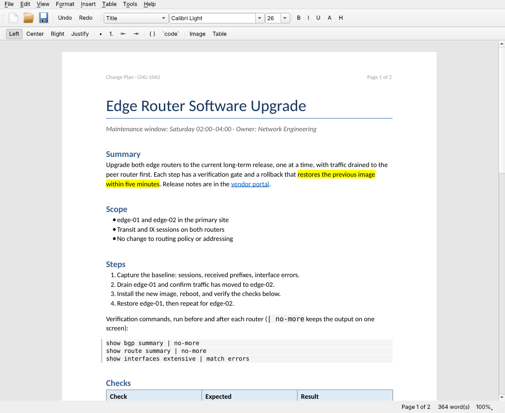
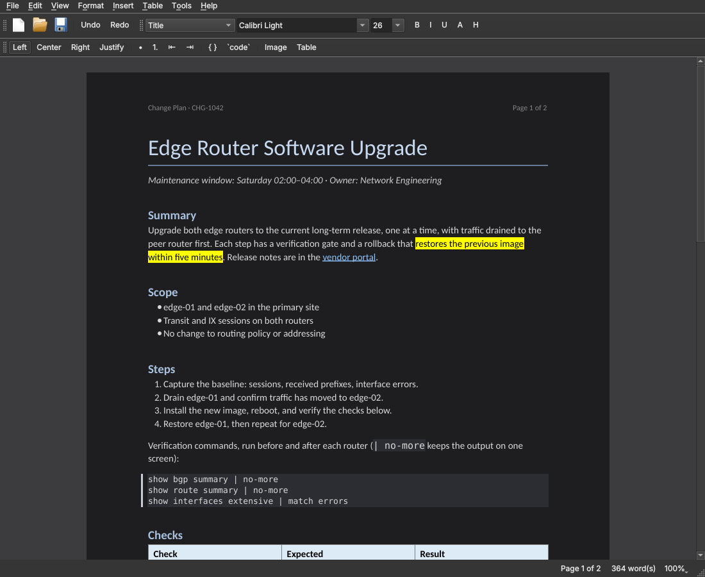
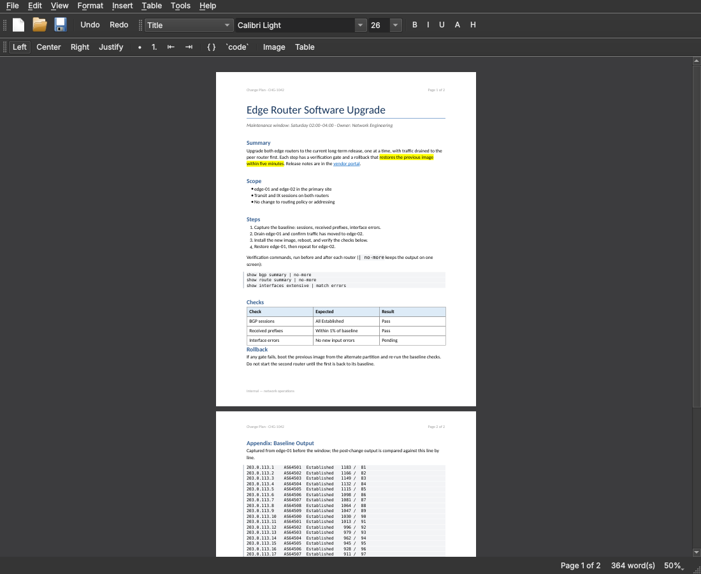

# anyprocessorqt

A lightweight DOCX word processor in Qt. One native app on Linux, ChromeOS (Linux container), macOS and Windows, reading and writing Word `.docx` directly — no LibreOffice, no conversion step.

Scope is deliberate: everyday word processing — fonts and paragraph formatting, styles, bullets and numbering, tables, embedded images, hyperlinks, page breaks — with clean round-trips to Word.

## Status

v0.1.0 — early. It opens, edits and saves real Word documents. Round-trip tests cover style-heavy resumes, long-form documents with images and callouts, and Word-template fixtures. See [What's preserved](#whats-preserved) before trusting it with documents that use tracked changes or comments.

## Screenshots

| Light theme, white paper | Dark theme, dark paper |
|---|---|
|  |  |



The sample document comes from `tools/make_screenshot_doc.py`; each image is one `--screenshot` run (see [Command-line tools](#command-line-tools)).

## Features

- **Text:** font family and size, bold, italic, underline, strikethrough, superscript/subscript, color, highlight, clear formatting
- **Paragraphs:** paragraph styles from the document (Normal, Title, Heading 1–n, List Paragraph, custom), alignment, indent, line spacing, spacing before/after, tab stops, paragraph borders (e.g. left-rule callouts), shading, page breaks
- **Lists:** bulleted and numbered, nested levels, Word style-driven lists (List Bullet / List Number), contextual spacing
- **Tables:** insert, add/remove rows and columns, merge/split cells; horizontal and vertical merges, cell shading and borders survive round-trips. Table → Table Properties… (also on the right-click menu inside a table): alignment, left/right cell padding, column widths in inches (Distribute Evenly, Fit to Page Width), borders (none, all, outside, inside, horizontal lines; width and color), and vertical alignment and shading for the selected cells, as one undo step
- **Code:** Code Block (Ctrl+Alt+C) and Inline Code (Ctrl+`). They're real named styles ("Code", "Inline Code") added to the document when first used: monospace, shaded, consecutive code lines packed together. Pasting into a code block keeps plain text and indentation, and spell check skips code
- **Find & Replace:** Ctrl+F / Ctrl+H open a bar under the editor with Match case, Whole words, Previous/Next (Shift+F3 / F3), Replace and Replace All; matches are counted and highlighted. Replacements keep the replaced text's formatting, and Replace All is one undo step
- **Images:** insert or paste PNG/JPEG/GIF/BMP/WebP, resize by % of text width; original image bytes are kept untouched on save
- **Hyperlinks:** external links and internal anchors
- **Views:** Page view (separate sheets, paginated exactly as print and PDF: same page breaks, same lines on each page; the status bar shows "Page N of M") and Draft view (text wraps to the full window). Zoom scales the page without moving a single line break: Fit Page Width (Ctrl+0, the default) fills the window, Ctrl+= / Ctrl+- and Ctrl+wheel step through 50–400%, and the zoom button in the status bar has presets. Switching views or zooming never touches the document
- **Theme and paper:** View → Theme sets the app to System, Light or Dark; View → Paper sets White or Dark paper, independently, so dark paper works with either theme. On dark paper, dark text colors (black, theme-colored headings, links) are lightened on screen, light gray shading (code blocks, inline code) turns into a dark card, and text on other highlights, shading or light cell fills keeps dark ink. Display only: save, print and PDF use the document's real colors on white
- **Spelling:** check as you type with suggestions, Add to Dictionary and Ignore All on right-click, F7 for the next misspelling. Built-in US English plus any Hunspell dictionaries installed on the system. Acronyms (BGP), mixed-case names (NetBox), words with digits, URLs, paths and file names are skipped, and a built-in list covers common network and software terms
- **Headers and footers:** shown on every page in Page view (dimmed, like Word), with page numbers and page counts filled in; different first page and even/odd pages are honoured. Double-click a page's top or bottom margin, or use Insert → Header & Footer…, to edit them: text with alignment, bold/italic, tab stops and `{PAGE}` / `{NUMPAGES}` fields, plus a Different first page switch. Headers with images, tables or other fields are kept exactly as they are and shown read-only
- **Files:** File → Open Recent lists the last ten documents (missing ones greyed out), with Clear List
- **Help:** About anyprocessorqt and About Qt (Qt version and license)
- **Output:** save `.docx`, export PDF and print with headers, footers and paragraph borders, page for page as Page view
- **Fonts:** Calibri, Cambria, Arial, Times New Roman and Courier New fall back to metric-compatible open fonts (Carlito, Caladea, Liberation) when the Microsoft fonts aren't installed, so line breaks match Word. Georgia maps to Gelasio when it's installed.

## How saving works

A `.docx` is a zip of XML parts. anyprocessorqt regenerates only what the editor owns — `word/document.xml`, its relationships, media it added, and numbering definitions for lists you create. Everything else in the package (`styles.xml`, theme, settings, headers/footers, font table, custom properties) is carried through byte-for-byte.

Paragraph and run formatting are written as differences from the paragraph's style, so a document edited here still responds to "modify style" in Word.

## What's preserved

| Content | Behaviour |
|---|---|
| Styles, theme, settings, headers/footers, section setup | Kept unchanged |
| Paragraph/run formatting, lists, tables, inline images, hyperlinks | Edited and written back |
| Headers and footers | Kept in the file; not shown or editable yet |
| Tracked changes | **Insertions are accepted and deletions dropped on save.** Accept or reject changes in Word first. |
| Comments, footnotes, endnotes | Their parts are kept, but the anchors in the text are not, so they detach on save |
| Floating (anchored) images | Read as inline images |
| Shapes, text boxes, charts, SmartArt, equations | Not shown; lost on save |
| Section breaks inside the document | Collapsed to the final section's page setup |

## Install

Download from [Releases](https://github.com/scottpeterman/anyprocessorqt/releases):

| Platform | File |
|---|---|
| Linux / ChromeOS, Intel/AMD | `anyprocessorqt-<version>-x86_64.AppImage` |
| Linux / ChromeOS, ARM | `anyprocessorqt-<version>-aarch64.AppImage` |
| macOS (Apple Silicon) | `anyprocessorqt-<version>-macos-arm64.dmg` |
| Windows | `anyprocessorqt-<version>-windows-x64.zip` |

`uname -m` tells you which Linux file you need.

### Linux and ChromeOS (AppImage)

The AppImage bundles Qt with its X11 and Wayland plugins, so nothing else from Qt is needed. AppImages mount themselves with FUSE, and Office documents need the metric-compatible fonts:

```bash
sudo apt install libfuse2 fonts-crosextra-carlito fonts-crosextra-caladea fonts-liberation2
chmod +x anyprocessorqt-*.AppImage
./anyprocessorqt-0.1.0-x86_64.AppImage
```

Without FUSE, run it with `--appimage-extract-and-run`. Every release is tested in a stock Debian bookworm container (the ChromeOS Linux base) under both X11 and Wayland.

The x86_64 AppImage bundles Qt 6.10. The aarch64 one bundles Debian bookworm's Qt 6.4.2, because the Qt installer's ARM64 builds need a newer glibc than bookworm has.

### macOS

Open the DMG and drag anyprocessorqt to Applications. The app is ad-hoc signed, not notarized: the first time, right-click it and choose Open.

### Windows

Unzip anywhere and run `anyprocessorqt.exe`.

## Build

Requirements: CMake ≥ 3.19, a C++17 compiler, Qt ≥ 6.4 (Core, Gui, Widgets, PrintSupport). No other libraries: the zip reader/writer is built in, and Hunspell and its English dictionary are vendored in `third_party/` (see `third_party/README.md` for versions and licenses).

```bash
cmake -S . -B build -DCMAKE_BUILD_TYPE=Release
cmake --build build -j
./build/anyprocessorqt [file.docx]
```

### ChromeOS (Linux container, Debian bookworm)

```bash
sudo apt install build-essential cmake qt6-base-dev qt6-wayland fonts-crosextra-carlito fonts-crosextra-caladea fonts-liberation2
cmake -S . -B build -DCMAKE_BUILD_TYPE=Release
cmake --build build -j
./build/anyprocessorqt
```

Bookworm ships Qt 6.4.2, the minimum supported version. The `fonts-crosextra-*` packages supply Carlito and Caladea, the metric-compatible stand-ins for Calibri and Cambria — without them Word documents reflow.

To open `.docx` files from the ChromeOS Files app, install the app (`sudo cmake --install build`) and add a desktop entry with `MimeType=application/vnd.openxmlformats-officedocument.wordprocessingml.document;`.

## Command-line tools

The same binary has headless modes for testing and scripting:

```bash
anyprocessorqt --roundtrip in.docx out.docx   # read and write back
anyprocessorqt --pdf in.docx out.pdf          # paginated PDF
anyprocessorqt --render in.docx out.png       # one tall image of the page view
anyprocessorqt --inspect in.docx              # paragraphs with style, list, border info
anyprocessorqt --dump in.docx                 # parsed document as Qt HTML
anyprocessorqt --screenshot out.png in.docx   # editor window screenshot
```

`--view page|draft`, `--theme system|light|dark` and `--paper white|dark` set (and save) the view, theme and paper for the GUI and `--screenshot`.

```bash
anyprocessorqt --theme dark --paper dark --screenshot out.png in.docx
```

## Spelling

The personal dictionary is a plain text file, one word per line:

| Platform | Location |
|---|---|
| Linux / ChromeOS | `~/.local/share/anyprocessorqt/anyprocessorqt/personal-dictionary.txt` |
| macOS | `~/Library/Application Support/anyprocessorqt/anyprocessorqt/personal-dictionary.txt` |
| Windows | `%APPDATA%\anyprocessorqt\anyprocessorqt\personal-dictionary.txt` |

Other languages: install a Hunspell dictionary (`sudo apt install hunspell-de-de`, for example) or drop a `.aff`/`.dic` pair into the app data `dictionaries` folder, then pick it under Tools → Spelling Language.

## Tests

```bash
./build/anyprocessorqt_tests tests/fixtures/features.docx tests/fixtures/headers.docx [more.docx ...]
```

Builds a document the way the editor does (styles, lists, nested levels, tables with merges and shading, images, links, highlight, breaks), saves it twice and checks that everything reloads and that numbering and media don't accumulate. Each extra file is round-tripped and compared block by block. `tools/compare_docx.py` gives an independent comparison through python-docx; `tools/make_fixture.py` regenerates the fixture.

## Roadmap

- Regular-expression search
- More bundled spelling dictionaries

## Releasing

Set the version in `project(anyprocessorqt VERSION x.y.z)` in `CMakeLists.txt`, commit, then tag it:

```bash
git tag v0.1.0
git push origin v0.1.0
```

`.github/workflows/release.yml` builds and tests every package, runs the AppImages in Debian bookworm under X11 and Wayland, and publishes the release with `SHA256SUMS.txt`. The tag must match the CMake version. Packaging scripts live in `packaging/`.

## License

GPL-3.0 — see [LICENSE](LICENSE).
